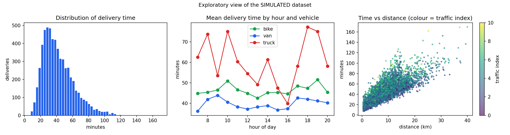
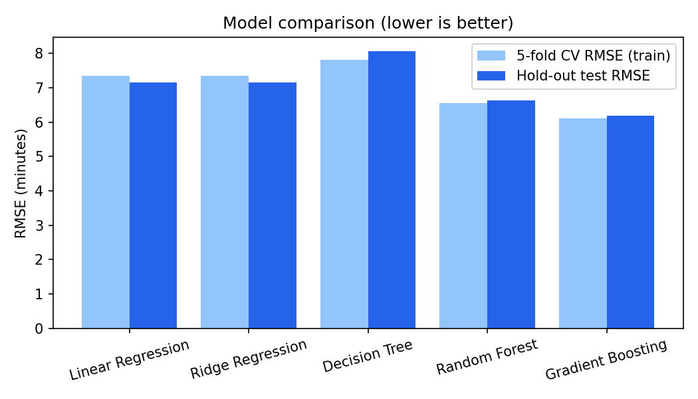
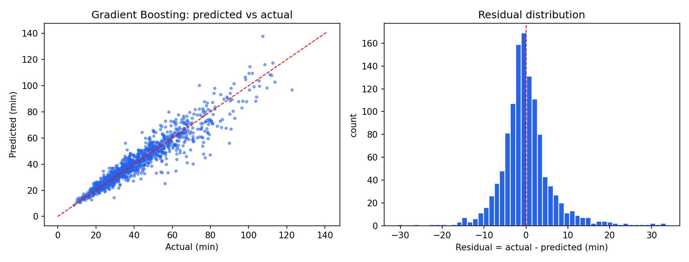
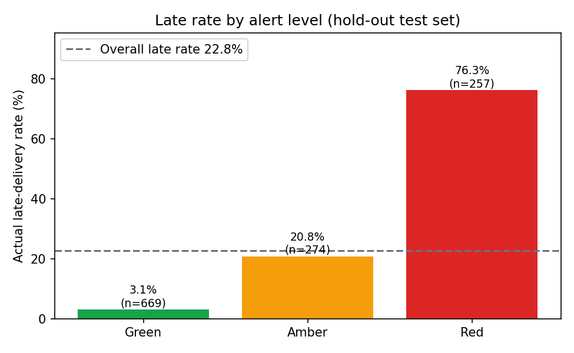
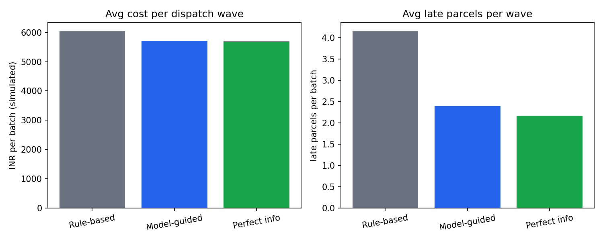

# Predictive Modeling and Optimization in Logistics Systems

**Delivery-time forecasting with machine learning, plus data-driven dispatch, traffic-risk alerts, vehicle allocation and route-planning improvements.**

> ## ⚠️ Dataset transparency
> **All data in this repository is SIMULATED.** It is generated by [`src/simulator.py`](src/simulator.py) with a fixed random seed. It is **not** real company data, and no real organisation, driver or customer is represented. Every result below (including cost and time savings) is a result on this simulated system and demonstrates the *method*, not a measured saving for a real business.

📄 **Full report:** [Word (.docx)](report/Logistics_Predictive_Modeling_Report.docx) · [PDF (viewable on GitHub)](report/Logistics_Predictive_Modeling_Report.pdf)

---

## 1. Problem

Predict **`delivery_time_min`** (minutes from dispatch to delivery) for last-mile deliveries *at dispatch time*, then use the forecast for operational decisions. The business baseline is a rule-of-thumb ETA (`14 + 3.0 × km + 2.0 × (stops − 1)`) that ignores traffic, weather and vehicle type; 21.1% of simulated deliveries exceed it.

## 2. Dataset (simulated)

6,000 deliveries over one simulated year, 12 input features (distance, weight, stops, hour, weekday, traffic index, driver experience, load, vehicle type, weather, zone, priority) and the target. About 1.5% missing values are injected on purpose to demonstrate preprocessing. See the report (Section 2) for the data-generating process.



## 3. Models and evaluation

Six models compared with identical 5-fold cross-validation: mean baseline, linear regression, ridge, decision tree, random forest, gradient boosting. Four were tuned with randomized search. The winner was chosen on **cross-validation RMSE only**; the hold-out test set (1,200 deliveries) was used once.

**Why these metrics?** **MAE** = typical error in minutes (easy to explain, robust to outliers). **RMSE** = penalises large misses, which matter most for late deliveries (used for model selection). **R²** = share of variation explained, comparable against the mean baseline.

| Model | Test MAE (min) | Test RMSE (min) | Test R² |
|---|---|---|---|
| Mean baseline | 15.28 | 19.27 | -0.000 |
| Linear Regression | 5.12 | 7.16 | 0.862 |
| Ridge Regression | 5.11 | 7.16 | 0.862 |
| Decision Tree | 5.60 | 8.06 | 0.825 |
| Random Forest | 4.55 | 6.62 | 0.882 |
| Gradient Boosting | 4.15 | 6.18 | 0.897 |

**Best model: Gradient Boosting** → MAE **4.15 min**, RMSE **6.18 min**, R² **0.897**. Rule-of-thumb ETA has MAE 9.92 min. Because the data are simulated, a *perfect* predictor of the expected time would still have RMSE 5.78 min (irreducible noise), so the model is close to the achievable ceiling.




## 4. From prediction to optimization

Decisions use the model's predictions; outcomes are scored with the simulator's noise-free ground truth (not the model itself).

| Module | What it does | Simulated result |
|---|---|---|
| **Dispatch planning** | Shift flexible (standard-slot) peak-hour deliveries up to 2 h to cheaper hours | −3.6% on-road minutes for eligible deliveries; 75% of perfect-information saving |
| **Traffic-risk alerts** | Green / Amber / Red vs promised ETA, with safety buffer and reason tags | Red late rate 76.3% vs Green 3.1%; Red+Amber catches 92.3% of late deliveries |
| **Vehicle allocation** | Hungarian-algorithm assignment minimising cost + lateness | Cost −5.4%, late parcels −42.4% vs rule-based dispatcher |
| **Route planning** | Stop sequencing with 2-opt, with and without model-based traffic costs | Route time −6.9% (2-opt). **Traffic-aware costs added only 0.03%**: reported honestly as a negative finding |




## 5. Reproduce everything

```bash
git clone <this-repo-url>
cd logistics-delivery-time-prediction
python -m venv .venv && source .venv/bin/activate      # Windows: .venv\Scripts\activate
pip install -r requirements.txt

python src/run_pipeline.py          # data -> models -> optimisation (~2-5 min on one CPU)
python verify_reproducibility.py    # re-runs from scratch in a temp folder and checks results match
```

`verify_reproducibility.py` re-runs the entire pipeline and compares every headline number with the committed results (tolerance 0.001) and requires the regenerated dataset to be byte-identical. It exits with code 0 only if everything reproduces.

Individual steps: `python src/generate_data.py` → `python src/train_models.py` → `python src/optimize.py`.

To rebuild the Word report (requires Node.js): `cd report && npm install docx && node build_report.js`.

## 6. Repository structure

```
├── README.md
├── requirements.txt
├── verify_reproducibility.py
├── data/delivery_data.csv            SIMULATED dataset
├── src/
│   ├── common.py                     paths, seed, features, split
│   ├── simulator.py                  data-generating process (digital twin)
│   ├── generate_data.py              step 1
│   ├── train_models.py               step 2: CV, tuning, evaluation
│   ├── optimize.py                   step 3: dispatch, alerts, allocation, routes
│   └── run_pipeline.py
├── results/                          metrics (JSON/CSV), trained model, figures/
└── report/                           report generator + Word report
```

## 7. Limitations

Simulated data (real data will give lower accuracy and needs re-validation); optimisation gains are evaluated on the same simulator; cost rates are illustrative assumptions; no concept drift; simplified allocation (one parcel per vehicle) and routing (fixed 20×20 km city). Details in Section 8 of the report.

## 8. Author

Prepared by **Shruti Rani**

## License

MIT, see [LICENSE](LICENSE).
